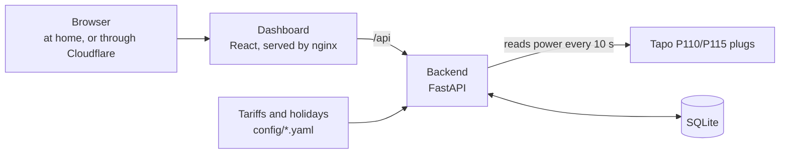

# tapo-energy-cost

Measures how much energy the appliances plugged into TP-Link Tapo P110/P115 smart plugs use, and
calculates what that energy costs under UTE's *Plan Inteligente Hogares* (Uruguay's three-band
time-of-day tariff: Valle, Llano and Punta).

**[Try the live demo](https://tapo.zorrozuanicolas.com)**: it needs no plugs or installation, and all its data is
made up in your browser ([why](docs/decisions/0018-public-demo.md)). The dashboard is in Spanish.

- **Backend:** FastAPI and SQLite. It reads each plug every 10 seconds, stores the energy by hour, prices it when it
  is read, and streams the live power.
- **Frontend:** React, TypeScript and Tailwind, with views by day, week and month.
- **Running it:** Docker Compose, in daily use on a Raspberry Pi, with optional remote access through Cloudflare and
  database backups.
- **Why it is built this way:** each design decision is recorded in [`docs/decisions/`](docs/decisions/).

## How it works



The backend turns the power readings into energy per hour, and calculates the cost when the data is read, with the
tariff and holidays of each hour. If it was off for a while, it recovers up to a week of hours from the plugs.

## What it looks like

Three tabs (today, week and month) show what each plug used and cost, a chart of the consumption by hour, day or
month with the cost of each bar in a tooltip, and what each plug is drawing right now. The screenshots use fake plugs
and demo data.


## Quick start

You need Docker with Compose.

```sh
docker compose up -d --build     # then open http://localhost:8080
docker compose down              # stop it; the data stays in ./data
```

On Linux, such as a Raspberry Pi with a 64-bit OS, create the database folder first. The app runs as user 1000, which
must own it:

```sh
mkdir -p data && sudo chown 1000:1000 data
```

Without any configuration the plugs are **fake**. To change that, copy [`.env.example`](.env.example) to `.env` in the
root folder (it is ignored by git), list your plugs in [`config/outlets.yaml`](config/outlets.yaml), and run
`docker compose up -d` again:

- **Demo data:** set `SEED_DEMO_DAYS=30`. It only fills a database with no energy data yet.
- **Real plugs:** set `TAPO_MOCK=false`, `TAPO_USERNAME` and `TAPO_PASSWORD` (keep the password in single quotes).
  Fake readings are stored in the same database, so if you tried the app with fake plugs, stop it and delete `data/`
  first.

> **Only one machine may poll the same plugs.** Do not run in real mode on your PC while another machine, such
> as a Raspberry Pi, is already polling them.

**There is no login:** keep the dashboard on your home network, or add one as described in
[Remote access](docs/deployment.md#remote-access).

## Documentation

- [Deployment](docs/deployment.md): updating, logs, remote access, backups and moving to another machine.
- [Development](docs/development.md): running the backend and the frontend without Docker, tests, the API and the
  public demo.
- [Design decisions](docs/decisions/): why it is built this way.

## License

[MIT](LICENSE) © 2026 Nicolás Zorrozúa
