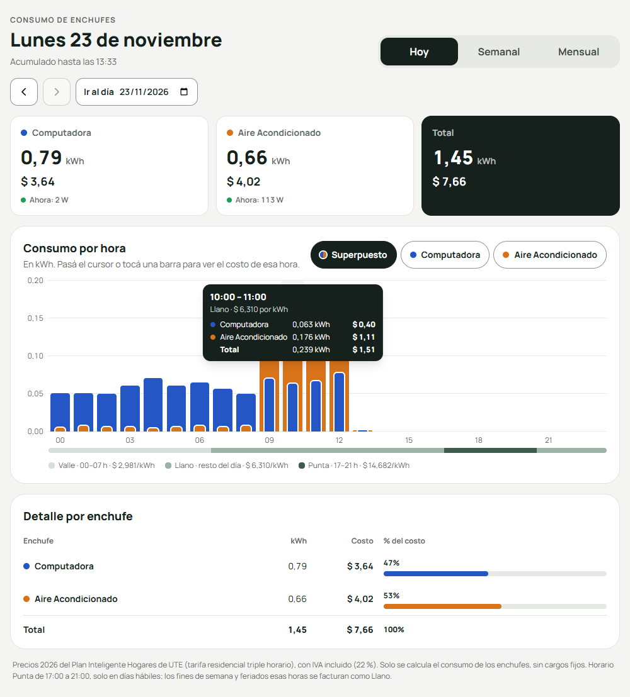
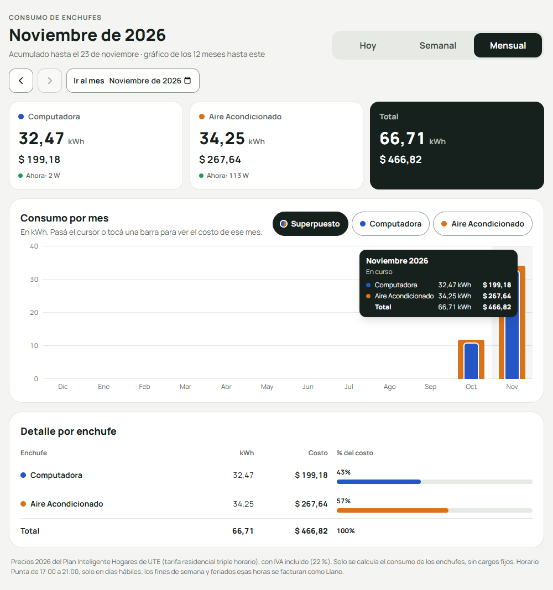

# tapo-energy-cost

Measures how much energy the appliances plugged into TP-Link Tapo P110/P115 smart plugs use, and
calculates what that energy costs under UTE's *Plan Inteligente Hogares* (Uruguay's three-band
time-of-day tariff: Valle, Llano and Punta).

> 🚧 **Work in progress.** This project is being rebuilt step by step, with every design decision
> documented.

## What it looks like

Three tabs (today, week and month) show what each plug used and cost, a chart of the consumption by hour, day or
month with the cost of each bar in a tooltip, and what each plug is drawing right now. The screenshots use fake plugs
and demo data.





## Running with Docker

The quickest way to run the whole app. You need Docker with Compose.

```sh
docker compose up -d --build     # then open http://localhost:8080
docker compose ps                # is it running and healthy?
docker compose logs --since 24h backend
docker compose down              # stop it; the data stays in ./data
```

On Linux, such as a Raspberry Pi with a 64-bit OS, create the database folder first. The app runs as user 1000, which
must own it:

```sh
mkdir -p data && sudo chown 1000:1000 data
```

Without any configuration the plugs are **fake**. To change that, copy [`.env.example`](.env.example) to `.env` in the
root folder (it is ignored by git):

- **Demo data:** set `SEED_DEMO_DAYS=30`. It only fills a database with no energy data yet.
- **Real plugs:** set `TAPO_MOCK=false`, `TAPO_USERNAME` and `TAPO_PASSWORD` (keep the password in single quotes).
  Fake readings are stored in the same database, so if you tried the app with fake plugs, stop it and delete `data/`
  first.

> **Only one machine may poll the same plugs.** Do not run in real mode on your PC while another machine, such
> as a Raspberry Pi, is already polling them.

| After changing | Run |
|---|---|
| `.env` | `docker compose up -d` |
| `TIMEZONE`, or the code (after `git pull`) | `docker compose up -d --build` |
| A file in `config/` | `docker compose restart backend` |

Only the dashboard's port is published, and **there is no login**: keep it on your home network, or add one as
described in [Remote access](#remote-access). The reasoning behind this setup is in
[0014](docs/decisions/0014-docker-deployment.md).

### Logs

Docker keeps the last 30 MB of each container's log, and discards it when the container is recreated, for example on
an update. On Linux the logs can go to the systemd journal instead, with the rest of the machine's logs. Add this to
`.env` and run `docker compose up -d`:

```
COMPOSE_FILE=docker-compose.yml:docker-compose.journald.yml
```

`docker compose logs` works as before. `journalctl CONTAINER_NAME=tapo-energy-cost-backend-1` reads the same lines,
including those of earlier containers. How long they are kept depends on the journal's settings, and they survive a
reboot only if the journal is persistent.

### Remote access

Optional: reach the dashboard from outside your home through a Cloudflare Tunnel, without opening a router port. You
need a Cloudflare account and a domain whose DNS Cloudflare manages. `energy.example.com` stands for your address,
and the names in Cloudflare's dashboard may differ slightly.

1. **Add the login first.** In Zero Trust, create a self-hosted **Access** application for `energy.example.com`,
   with an *Allow* policy that includes only your email address (a one-time PIN by email works as the login method).
2. Create a **Tunnel** (cloudflared) and give it a public hostname: `energy.example.com`, with the service
   `http://frontend:8080`.
3. In `.env`, set the tunnel's token (it is a secret) and enable the tunnel:

   ```
   TUNNEL_TOKEN=<the token>
   COMPOSE_PROFILES=tunnel
   ```

4. Run `docker compose up -d`.
5. **Check it:** open the address in a private browser window, for example on a phone using mobile data. It must ask
   you to log in before showing anything. If it does not, run `docker compose stop cloudflared` and review step 1.

If the tunnel does not connect, see `docker compose logs cloudflared`.

### Backups

With the app running:

```sh
scripts/backup.sh                    # on Windows: docker compose exec backend python -m app.backup
scripts/backup.sh --keep-days 30     # the default is 14
```

It writes `data/backups/tapo-<date and time in UTC>.db.gz`, safely while the app keeps running, checks it, and deletes
older backups.

**Every day,** on Linux, add a line like this with `crontab -e`, with your own paths:

```
15 3 * * * /home/<user>/tapo-energy-cost/scripts/backup.sh >> /home/<user>/tapo-backup.log 2>&1
```

Look at that log now and then: nothing else reports a failed backup.

**Copy them to another machine.** The backups are on the same disk as the database, so a disk failure takes both.
For example, from your PC:

```sh
scp -r <user>@<address>:tapo-energy-cost/data/backups .
```

**Or upload them every night** with [rclone](https://rclone.org/drive/), for example to Google Drive. Set up a remote
called `gdrive` (create your own Google client ID, and choose the `drive.file` scope, which reaches only the files
rclone created). Then use this line in `crontab -e` instead of the one above:

```
15 3 * * * { /home/<user>/tapo-energy-cost/scripts/backup.sh && /usr/bin/rclone copy /home/<user>/tapo-energy-cost/data/backups gdrive:tapo-backups --include 'tapo-*.db.gz' -v && echo 'Upload finished' || echo 'Backup or upload FAILED'; } 2>&1 | logger -t tapo-backup
```

`journalctl -t tapo-backup` shows the results. `rclone copy` never deletes from the destination, so old backups
accumulate there.

**Restore** a backup (change the file name). The current database is renamed to `old-tapo.db`, with its `-wal` and
`-shm` files, replacing the one kept by an earlier restore. Leaving those two files next to a restored database could
damage it.

```sh
docker compose stop backend
docker compose run --rm --no-deps -e BACKUP=tapo-20261125-061500Z.db.gz backend sh -ec '
  cd /srv/data
  gzip -t "backups/$BACKUP"
  for f in tapo.db tapo.db-wal tapo.db-shm; do [ ! -e "$f" ] || mv "$f" "old-$f"; done
  gunzip -c "backups/$BACKUP" > tapo.db'
docker compose start backend
```

With real plugs, the app then recovers up to a week of the hours recorded after the backup.

**Moving to another machine:** stop the app on the old one, back up, and copy the file to `data/backups/` on the new
one. Restore it there **without the last command**, as a backend with no `.env` uses fake plugs and would add their
readings to your history. Set the real plugs in `.env`, then run `docker compose up -d`.

Without Docker, `uv run python -m app.backup` in `backend/` backs up the database set there. The reasoning behind
backups and remote access is in [0015](docs/decisions/0015-remote-access-and-backups.md), and the setup of a
Raspberry Pi host in [0017](docs/decisions/0017-raspberry-pi-host.md).

The two sections below run each part without Docker, for development. They use their own settings file
(`backend/.env`) and database.

## Running the backend

You need Python 3.12 or newer and [uv](https://docs.astral.sh/uv/).

```sh
cd backend
uv sync                 # install the dependencies
uv run pytest           # run the tests
uv run uvicorn app.main:create_app --factory
```

The app is built by `create_app()` and there is no module-level `app`, so `--factory` is required
([why](docs/decisions/0007-rest-api.md)). On the first start it creates `backend/data/tapo.db` and applies the
database migrations by itself. The plugs are listed in [`config/outlets.yaml`](config/outlets.yaml).

By default the plugs are **fake** (`TAPO_MOCK=true`): nothing touches the network or a real plug, so you can try
everything without hardware. Once it is running:

- `GET /api/health` and `GET /api/outlets`: the configured plugs.
- `GET /api/live`: a stream of live power readings (`curl -N http://127.0.0.1:8000/api/live`).
- `GET /api/consumption?granularity=day&from=2026-11-01&to=2026-11-08`: energy and cost per plug.
- `GET /api/tariff`: the tariff in force today.
- `/docs`: the interactive API reference.

The history views are empty on a fresh database. To try them, start the app with `SEED_DEMO_DAYS=30` for 30 days of
fake hourly data. It only fills a database with no energy data yet, and it needs the fake plugs
([why](docs/decisions/0011-demo-seed.md)).

### Using the real plugs

Copy `backend/.env.example` to `backend/.env` (it is ignored by git) and set:

```
TAPO_MOCK=false
TAPO_USERNAME=<your Tapo account>
TAPO_PASSWORD=<its password>
```

> **Only one machine may poll the same plugs.** Do not run in real mode on your PC while another machine, such
> as a Raspberry Pi, is already polling them.

On startup, and then every 6 hours, the app also imports each plug's own hourly history (about a week), which
fills the gaps left by outages. Raw readings older than `RAW_RETENTION_DAYS` are deleted; the hourly totals are
kept ([why](docs/decisions/0010-pruning-and-backfill.md)).

Set `POLLER_ENABLED=false` to run only the API, without reading any plug. Every setting is documented in
[`backend/.env.example`](backend/.env.example), and the reasoning behind the design is in
[`docs/decisions/`](docs/decisions/).

## Running the frontend

You need Node 22 (the version is in [`frontend/.nvmrc`](frontend/.nvmrc)) and the backend running on port 8000.

```sh
cd frontend
npm ci                  # install the dependencies from package-lock.json
npm run dev             # the app at http://localhost:5173
npm test                # run the tests
npm run check           # lint, format and import order (Biome)
npm run build           # type check (strict) and production build
```

The dev server forwards `/api` to the backend, so no CORS setup is needed. To see the screen with no real plug,
start the backend with its defaults (fake plugs) and `SEED_DEMO_DAYS=30`, as described above. If the API is on
another address, or the plugs are in another time zone, copy [`frontend/.env.example`](frontend/.env.example) to
`frontend/.env.local` and set `VITE_API_URL` or `VITE_TIMEZONE`. The reasoning behind the screen is in
[0013](docs/decisions/0013-dashboard-views.md).

## License

[MIT](LICENSE) © 2026 Nicolás Zorrozúa
